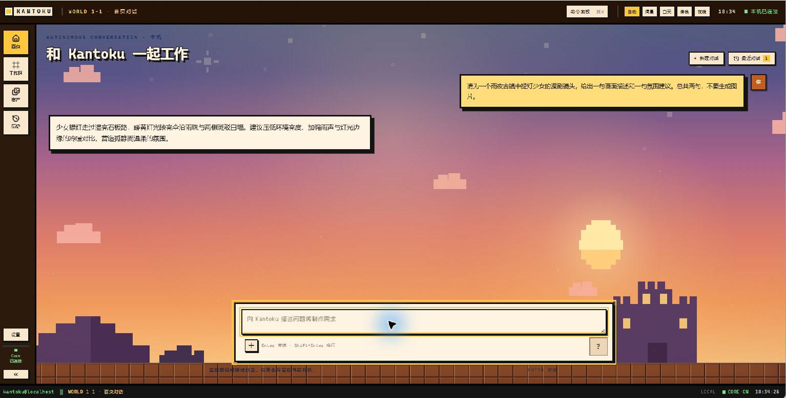
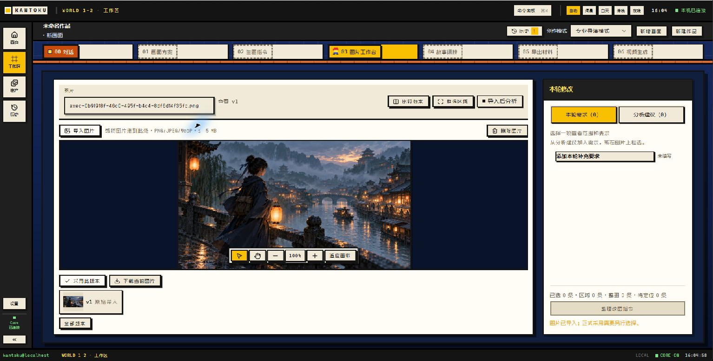

# kantoku-agent（AI 漫剧副导演）


Kantoku 是面向漫剧创作者的**本地优先 AI 工作台**。用户通过对话描述一个画面，
逐步整理导演方案和生图提示词；导入图片后，可以查看分析建议、框选修改区域、
比较版本，再把采用的画面组织成故事与导出材料。

它希望减少创作者在多个工具之间反复复制设定、追踪图片版本和整理镜头资料的工作。
前端使用 Vue 3，后端使用 FastAPI、SQLite 和统一运行时。

**项目状态：本地优先的预览项目。** 当前为单机使用，不提供公网多人数据隔离；默认视频 Provider 是 Mock，
不能生成真实成片。真实供应商调用需要自行配置密钥，可能产生费用。完整限制见[当前边界](#当前边界)。

**个人职责与开发方式：** 由项目作者主导需求、产品方向和架构决策，借助 AI 辅助编写和修改代码，
并结合实际运行和测试进行验证与迭代。

**技术栈：** Python 3.11–3.12、FastAPI、SQLite、Vue 3、TypeScript、Vite、pytest。

**从这里开始：** [界面预览](#界面预览) · [使用流程](#使用流程) ·
[技术亮点](#技术亮点) · [快速开始](#快速开始) · [测试与评测](#测试与评测) ·
[当前边界](#当前边界)

## 界面预览

**对话首页**：用自然语言描述创作需求，并查看回复。



**图片工作台**：查看镜头画面与分析建议，框选需要关注的区域。



截图取自独立本机演示环境。示例镜头由外部图像生成工具制作后导入工作台，
用于展示图片管理界面；它不代表项目内部生图的实测结果。[查看示例原图](assets/demo/rainy-bridge.png)。

## 使用流程

以制作一个画面为例：

1. 在工作区描述创意，查看并确认导演方案，再整理当前画面的生图指令。
2. 将提示词交给外部图像工具，导入生成结果，在图片工作台查看建议、框选区域并整理改图指令。
3. 导入修改后的版本并比较，采用合适的画面；有多个画面时，可继续编排故事和导出材料。

下表列出工作台中的主要入口。图片分析与文本生成需要配置相应供应商；示例截图中的图片是外部生成后导入的。

| 环节 | 能力 |
|---|---|
| 创作对话 | 自然语言交互；新的创作需求可形成独立方案，支持 `fast` / `professional` 执行模式 |
| 01 画面方案 | 导演上下文（DirectorSpec）、分镜方案、专业评审（Critic）与装配 |
| 02 生图指令 | Prompt 编译、语义约束核验、四段式提示词与产物交付 |
| 03 图片工作台 | 导入图片、查看分析建议、框选区域并整理改图指令；报告按图片内容指纹归属，支持版本比较与回退 |
| 04 故事编排 | 故事初稿、结构校验（缺镜头/动作/运镜/时长由确定性规则给出）和内容一致性校验 |
| 05 导出材料 | 交付清单与素材导出 |
| 06 视频生成 | 视频阶段的素材组织与提交入口；当前 Provider 为 Mock |
| 资产库 | 角色、场景、素材的统一管理与复用 |
| 任务中心 | 任务、批次与运行记录 |

## 技术亮点

- **工作流与恢复：** 在共享运行时中组织节点、状态和事件；导演方案与后续产物关联，保留历史修订。
- **上下文和结构化输出：** 按预算整理会话上下文，使用结构化模型校验导演方案与相关字段；模型推断和用户明确要求分开标识。
- **图片审阅与版本：** 支持分析建议和区域选择；审阅报告与图片内容指纹绑定，减少版本切换时引用错误结果。
- **预算与可验证边界：** 图片请求复用预算台账，未知账单保留待对账状态；离线测试、模拟结果和真实模型验收分别说明。

## 架构

分层与调用方向是硬约束（详见 [AGENTS.md](AGENTS.md) 与 [工程手册](docs/engineering/README.md)）：

```
Conversation → Unified Agent Orchestrator → Action / Plan
             → 直接调用 Capability 或走 Domain Workflow
             → Core Infrastructure → Provider
```

```
src/kantoku/
├── core/          Run / Workflow / Node / Artifact / Memory / Runtime Event / 文件台账
├── domains/       comic（漫剧）
├── capabilities/  image / video / creative / web_search —— 跨域共享的唯一入口
├── adapters/      外部平台协议适配
├── shells/        web_studio（API + SSE + 工作台）、cli、image_cli、qc_cli
├── config/        设置、日志、运行路径与临时文件台账
├── memory/        人设与素材检索
└── perception/    视觉质检

frontend/          Vue 3 + TypeScript + Vite 工作台
tests/             后端 pytest（离线可跑）
docs/              工程、产品、架构文档
```

目标边界是 Core 保持业务无关、Domain 复用 Core、Provider 负责协议、前端调用应用 API。
现有历史例外及兼容原因见[架构例外清单](docs/architecture/exceptions.md)。

### 关键代码入口

- [Agent 工具调用循环](src/kantoku/agent/loop.py)：接收消息并执行工具调用。
- [图运行时](src/kantoku/core/runtime/graph.py)：工作流节点、执行状态与恢复机制。
- [漫剧导演协调](src/kantoku/domains/comic/coordinator.py)：组织导演阶段和业务门禁。
- [漫剧提示词编译](src/kantoku/domains/comic/prompts.py)：将上下文和约束整理为结构化提示词。
- [Web API](src/kantoku/shells/fastapi_studio.py) 和 [前端源码](frontend/src/)：本机工作台的接口与交互。

## 快速开始

需要 Python 3.11–3.12、[uv](https://docs.astral.sh/uv/)、Node.js 20.19.x 或 22.12 及以上版本（Vite 7 要求）。

首次运行前，确认目标文件不存在后再复制配置模板；已有配置应保留。密钥只填写在本机，不要提交到 Git：

```bash
cp config/settings.example.yaml config/settings.yaml
cp config/.env.example .env
```

没有配置供应商密钥时仍可启动工作台，但依赖模型的功能不可用；调用真实服务可能产生费用。

前后端分别开发：

- **PyCharm 后端**：打开项目根目录 `kantoku-agent/`，将 Python 解释器设为项目的 `.venv`，运行共享配置 `Kantoku Backend`，或在根目录终端执行 `python -m kantoku serve`。后端源码位于 `src/kantoku/`，项目根目录还提供后端需要的 `config/`、`skills/` 和数据库配置。
- **VS Code 前端**：单独打开 `frontend/` 文件夹，在其终端执行 `npm install`（首次）和 `npm run dev`。开发页面为 `http://127.0.0.1:5173`，默认连接后端 `http://127.0.0.1:8000`；请同时启动后端。

`frontend/src/` 是唯一前端源码。`src/kantoku/shells/web/` 是同一份前端构建出的静态页面，供后端单独启动时使用，不在其中手工修改前端。运行数据和历史记录不因开发工具分开而移动。

### 本机账号

首次打开工作台可以创建用户名和密码，也可以选择暂时继续使用原有本机工作台。
创建账号后，该设备原有项目和历史由这个账号使用；本阶段只支持一个本机账号，
不提供手机号、微信、邮箱登录或多人数据隔离。用户名为 3–32 位中文、字母、数字、
下划线或短横线，密码为 8–128 个字符。

成功登录后，本机浏览器会保留最长 30 天的登录状态；正常重启后端不会要求重新登录。
选择侧栏“退出登录”、清除浏览器数据或登录状态过期后，需要再次输入用户名和密码。
目前没有找回密码功能，请妥善保存密码；登录状态只在本机浏览器有效，不是联网账号。
注册前系统会对原数据库执行一致性备份，不移动或删除现有项目、历史及素材。
本机服务器仍只监听回环地址；此功能不应当作公网部署或多人访问的安全方案。

```bash
# 后端：API + SSE + 生产工作台
uv sync
uv run python -m kantoku serve            # http://127.0.0.1:8000
uv run python -m kantoku serve --no-browser --port 8000
uv run python -m kantoku doctor           # 本机配置自检（不联网）
uv run python -m kantoku doctor --live    # 附加供应商连通性探测

# 前端开发服务器
cd frontend
npm install
npm run dev                               # http://127.0.0.1:5173
```

后端默认使用 FastAPI。启动后可在本机打开 `http://127.0.0.1:8000/docs` 查看和测试接口；
创建账号后需先在工作台登录。测试页面使用本地资源及原有会话保护，写入和生成接口会实际执行，
应使用隔离测试环境验证。需要临时回退到原 HTTP 服务时，可执行
`python -m kantoku serve --legacy-http`；关闭旧服务后才能用同一端口重新启动。

`config/settings.yaml` 与 `.env` 均已在 `.gitignore` 中。运行期数据
（`data/`、`logs/`、`tmp/`、`cache/`、`artifacts/`）也全部忽略，不进版本库。

## 测试与评测

常规离线测试使用隔离数据与替身，不需要调用付费模型；首次安装依赖仍需要联网：

```bash
uv run pytest                              # 后端离线测试
cd frontend
npm test                                   # 前端离线测试
npx vue-tsc --noEmit                       # 类型检查
```

[GitHub Actions](https://github.com/Jacklin-china/kantoku-agent/actions) 检查前端测试与构建、
项目结构以及部分后端运行时、图片审阅和评测测试；它不代表完整后端测试或真实模型验收全部通过。

评测材料和限制见 [evals/README.md](evals/README.md)。例如，图片工作台对照材料尚未
完成采集和人工确认，不能据此宣称画面质量或首次改对率已经提升。真实模型验收需要
单独确认预算与凭据，结果不由离线替身推断。

## 文档导航

| 文档 | 内容 | 何时读 |
|---|---|---|
| [AGENTS.md](AGENTS.md) | AI 协作入口与修改前必读清单 | 开始改代码前 |
| [docs/engineering/README.md](docs/engineering/README.md) | 分层边界、目标调用方向、改动顺序 | 定位实现位置前 |
| [docs/engineering/AI_CODE_RULES.md](docs/engineering/AI_CODE_RULES.md) | 代码红线、禁止平行实现 | 写代码前 |
| [docs/product/product-principles.md](docs/product/product-principles.md) | 产品原则与取舍 | 做功能决策前 |
| [docs/engineering/runtime-policy.md](docs/engineering/runtime-policy.md) | 运行文件、临时目录与台账规范 | 改存储/清理逻辑前 |
| [docs/architecture/](docs/architecture/) | 逐模块设计、上下文锁与[架构例外清单](docs/architecture/exceptions.md) | 改动涉及历史边界时 |
| [CONTRIBUTING.md](CONTRIBUTING.md) | 启动方式、日志查询、交付门禁 | 开发与验收时 |
| [docs/01](docs/01-开发规范.md)–[04](docs/04-功能开发引导.md) | 早期 10 周计划的开发规范与引导 | **仅作历史参考**，不反映当前实现 |

## 当前边界

诚实标注，避免把「已实现」误读成「已验收」：

- **供应商账单未验收**：成本台账在供应商不返回金额时保留 `unknown` 并等待对账，
  不会把估算冒充实扣；预算上限只覆盖已接入的生图账目，不含文本、配音与视频。
- **Commerce 功能已移除**：不能创建或继续执行电商任务；原始数据保留，不再在界面展示。
- **视频能力只有 Mock Provider**：返回的是 `mock://video/...` 逻辑产物，没有真实渲染、
  没有真实计费；接入真实视频服务前不得把结果称为成片。
- **画面质量需人工验收**：结构化校验与 Prompt 锚点校验通过，不等于成片可用。
- **已知失败测试**：仓库内仍有少量历史遗留失败用例（如 Critic 不可用时的导演确认路径），
  修复前需先确定产品契约。不会通过伪造 pass 或放宽门禁来消除。

## License

MIT，见 [LICENSE](LICENSE)。
