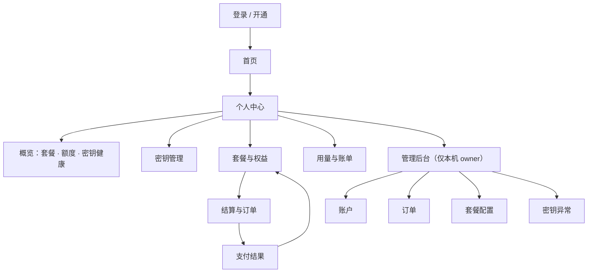
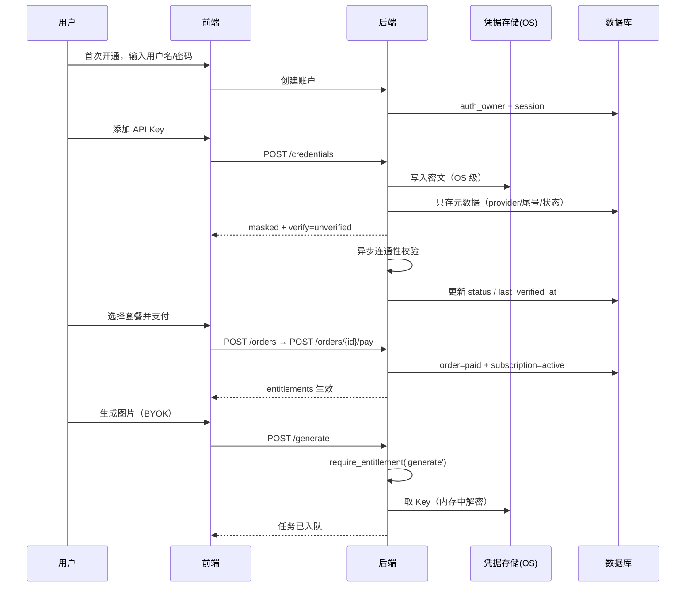

# 产品设计规格：账户 · 密钥 · 套餐与购买

- 版本：v1.0　编制日期：2026-11-22
- 角色：产品设计 / UX 设计（线框规格 + 交互注释 + 无障碍约束）
- 基线：`main = b4cbc20`；原型 `docs/design/account-workspace-ui.html`（已有：登录、创建账号、个人中心、我的作品、额度与用量）
- 范围：账户状态、自带密钥（BYOK）、套餐权益、购买与到期降级、最小管理后台
- 不覆盖：团队协作、多租户数据隔离、真实支付通道对接（仅设计适配器与沙箱）

---

## 0. 结论先行

你要的三件事（用户管理 / 自填 Key / 会员购买）不是三个功能，而是**一条"付费解锁软件能力"的链路**。这条链路有一个必须先解决的商业逻辑问题：

> 用户用自己的 Key、自己承担模型费用，为什么还要向你付费？

如果套餐页只写"开通会员才能使用你的 API Key"，转化率会很低——用户会认为在为一个自己已经付过费的东西再付一次。
**会员卖的不是模型调用权，是软件本身**：作品与版本的可追溯、资产的跨项目复用、故事与镜头编排、导出与批量、失败恢复与对账。

因此本规格的定位是：**订阅解锁"工作流与资产管理"能力；模型费用走两条路——自带 Key（用户自己付给供应商）或平台额度（用户付给你）。** 这套设计同时满足你提的三个诉求，也不会让付费显得像过路费。

三个必须你拍板的决策（不拍板无法开工，详见 §2）：D1 计费模型、D3 支付实现方式、D4 到期后怎么降级。

---

## 1. 现状基线（决定了改造量）

| 能力 | 现有实现 | 对本设计的含义 |
|---|---|---|
| 账户 | `auth_owner` 单账号、`auth_sessions` 30 天、`scrypt` 口令 | 有账户骨架，**无套餐、无订单、无权益** |
| 密钥 | 文字模型 Key 写入 **Windows 凭据管理器**（`CredWriteW`，OS 级加密）；视频 AccessKey 只存内存、进程退出即失；非 Windows 不允许保存 | 安全性其实达标，但**只有"值"，没有元数据**：无法展示"哪个 Key、何时校验、是否失效" |
| 密钥可改性 | `save_provider_credentials()` 仅支持文字模型；图片/视频不可在界面改 | BYOK 需要放开到三类，且必须与"共享 Key"解耦（`managed_text_key_allowed` 的既有保护不能破） |
| 额度 | 个人中心已有「额度与用量」；`ledger` 有预留/实扣/`unknown` | 额度概念可复用，**不要新建钱包**；套餐权益挂在额度之上 |
| 原型 | 账户原型已有登录/个人中心/作品/用量 | 缺三块：密钥管理、套餐、购买 |

结论：**账户与密钥不是从零做，是给已有机制补"元数据 + 权益 + 交易"。**

---

## 2. 三个决策（需拍板）

| 编号 | 决策 | 选项 | 判据 | 建议 |
|---|---|---|---|---|
| **D1** | 计费模型 | A 平台代付额度（卖额度）；B 纯订阅 + BYOK；C 混合：订阅解锁能力，额度可选 | ① 用户是否已有 Key；② 你是否愿意垫付模型成本；③ 退款与对账复杂度 | **C**。订阅解决"软件价值"，额度解决"不想折腾 Key 的用户"。单卖额度会把你变成模型转售商，承担全部对账与垫资风险 |
| **D2** | 套餐档位 | 2 档 / 3 档 / 4 档 | 认知成本 vs 升级空间 | **2 档 + 买断**：免费 / 专业（订阅）+ 永久买断。v1.1 修订——单一作者无套餐运营，三档的定价与权益维护成本翻倍，且两档已足够覆盖"想试"与"想用" |
| **D3** | 支付实现 | 真实商户接入 / 第三方聚合 / **沙箱 + 可插拔适配器** | 资质、退款责任、毕设周期 | **沙箱 + 适配器**。毕业设计阶段不接真实商户：资质、发票、退款争议都不在可控范围。接口按真实通道形状设计，后续替换适配器即可 |
| **D4** | 到期降级 | 立即锁死 / 宽限只读 / 保留全部 | 用户信任 | **宽限 7 天 + 永久只读 + 数据可导出**。锁死会让人不敢付费；"数据永远属于你"是这类工具最重要的信任资产 |

---

## 3. 信息架构



导航原则：**个人中心是唯一入口，不做二级侧栏**。现有原型已是这个结构（`AccountView.vue` + `.px-sheet` 分块），继续沿用，不新开页面体系。

---

## 4. 页面规格

> 约定：沿用现有 `px-*` 设计系统（`tokens.css` 定义色板/间距/圆角，`pixel-pages.css` 定义组件）。组件列标注「已有 / 待建」；颜色在此阶段不定，只标语义令牌。

### S1 密钥管理（新页，个人中心内分块）

**内容优先级**

- P1（首屏）：当前生效的 Key 清单（三条：文字 / 图片 / 视频）、每条的掩码与状态、主 CTA「添加密钥」
- P2：校验记录（最近一次连通性测试时间与结果）
- P3：凭据安全说明（不落明文、不进日志、不进导出包）
- 可降级：供应商文档外链

**组件映射**

| 元素 | 组件 | 变体/状态 | 备注 |
|---|---|---|---|
| 分组容器 | `px-sheet` + `px-sheet-hd/bd` | 已有 | 与现有个人中心一致 |
| Key 行 | `CredentialRow` | 待建：已配置 / 未配置 / 校验中 / 校验失败 / 已停用 | 三行固定顺序，不按状态重排 |
| 掩码文本 | `px-idchip` + 等宽字体 `--font-mono` | 已有 | 显示 `sk-••••••••3f2a` |
| 状态标记 | `StatusBadge` / `px-status` | 已有 | 绿=可用，黄=未校验，红=失效 |
| 主 CTA | `px-btn is-gold` | 已有 | 「添加密钥」 |
| 添加表单 | `px-provform` + `px-field` + `px-inp` | 已有（供应商表单同构） | 增加「用途」与「备注」两列 |
| 二次确认 | `px-modal` | 已有 | 删除/替换走模态 |
| 安全说明 | `px-note` | 已有 | 灰底说明块 |

**交互注释**

- 点「添加密钥」→ 展开行内表单（不弹模态）→ 条件：该 provider 已有 Key 时改为「替换」，并提示旧 Key 将失效。
- 保存 → 立即异步校验（≤8s）→ 状态由「校验中」变「可用」或「失败 + 原因分类」（`invalid_key` / `network` / `quota_exhausted` / `unsupported_region`）。
- 校验失败 → 表单不关闭、Key 已加密保存但不参与路由，显示「已保存，暂不可用」+ 「重新校验」。**不允许因为校验失败就丢弃用户输入**。
- 悬停 Key 行 → 显示「复制 Key 尾号」与「停用」两个次级动作；**永不提供"查看完整 Key"**（连 owner 也不给，避免肩窥与截图泄露）。
- 输入框失焦 → 前端只做格式预检（长度、空白字符），真实有效性只由服务端校验判定。
- 停用 → 模态确认 → 该 Key 从路由池移除，已在进行中的任务不受影响（避免半路断流）。

**状态矩阵**

| 状态 | 展示 | 主 CTA |
|---|---|---|
| 无任何 Key | 空态：说明"没有 Key 也可以先逛，生成时需要" | 添加密钥 / 了解套餐 |
| 有 Key 未校验 | 黄色「未校验」 | 校验 |
| 校验失败 | 红色 + 原因 + 「重新校验」 | 重新校验 / 替换 |
| 可用 | 绿色 + 最近校验时间 | 替换 / 停用 |

**响应式**：桌面（≥1200）表单两列（provider + 用途 / Key + 备注）；窄屏（<768）单列堆叠，Key 输入框 `type=password` 带显示切换。

**开放问题**：是否需要"按用途绑定"（例如某个 Key 只给图片用）— 待确认；若不需要，保留字段但默认「通用」。

---

### S2 套餐与权益（新页）

**内容优先级**

- P1：当前档位卡（档位名、剩余天数、到期日、主 CTA：续费/升级）
- P1：两档对比表（权益行 × 免费/专业列 + 一列"永久买断"），当前档位高亮
- P2：权益明细说明（每条权益一句话，指出对应界面位置）
- 可降级：常见问题（到期后我的作品会怎样、Key 会不会被删）

**组件映射**

| 元素 | 组件 | 变体/状态 | 备注 |
|---|---|---|---|
| 当前档位 | `PlanCard` | 待建：试用 / 正常 / 临期(<7d) / 已过期 | 临期用 `--warning` 语义 |
| 对比表 | `px-table` | 已有 | 列固定为「免费 / 专业 / 买断」三列（两档 + 一个买断出口），行按能力分组 |
| 权益行 | `FeatureRow` | 待建：可用 / 不可用 / 部分可用 | 不可用行用 `--text-muted` 并去饱和 |
| 主 CTA | `px-btn is-gold` | 已有 | 升级/续费 |
| FAQ | `px-note` 折叠 | 待建 Accordion | 键盘可达，`aria-expanded` |

**交互注释**

- 悬停权益名 → tooltip 说明"在哪个界面用到"（例：批量导出 → 作品页右上「导出」）。**权益必须可定位到界面，否则用户不认账。**
- 点「升级」→ 进入结算；若当前档位低于目标，文案为「立即升级，按剩余天数折算」，折算规则必须在页面上写出。
- 点「降级」→ 模态说明"到期后生效"，不立即扣减权益。
- 已过期 → 档位卡变为「已过期 · 只读模式」+ 「恢复全部功能」，对比表仍可看（允许付费，不羞辱用户）。

**开放问题**：试用期天数与是否需绑卡 — 待定；建议 7 天、不绑卡。

---

### S3 结算与订单（新页，模态或独立页）

**内容优先级**

- P1：订单摘要（档位、周期、单价、折算、应付）、支付方式、确认按钮
- P2：协议与自动续费说明（明确"不自动续费"或"可随时关闭"）
- 可降级：发票/凭证（个人项目可先提供订单号截图）

**组件映射**

| 元素 | 组件 | 变体/状态 | 备注 |
|---|---|---|---|
| 订单摘要 | `OrderSummary` | 待建：新购 / 升级折算 / 续费 | 金额右对齐、等宽数字 |
| 支付方式 | `px-fsel`（单选卡片） | 已有 | 沙箱阶段只有「模拟支付」并显式标注 |
| 主 CTA | `px-btn is-gold` | 已有 | 「确认支付 ¥x」 |
| 支付结果 | `px-result` | 已有 | 成功 / 处理中 / 失败三态 |
| 订单号 | `px-kvrow` | 已有 | 可复制，用于客服 |

**交互注释**

- 确认支付 → 按钮进入 loading 且禁用（防重复下单）→ 服务端以 `request_id` 幂等 → 结果页。
- 失败 → 结果页给「重试支付」与「换一种方式」；**订单号不变**，不生成新订单。
- 处理中 → 轮询或 SSE 更新，最长 60s；超时给「查询订单状态」而不是让用户重付。
- 支付成功 → 权益立即生效，回到套餐页并高亮"已生效"；同时在个人中心顶部出现一次性的成功提示。

**开放问题**：是否支持"按量充值额度"与"订阅"并存于同一结算页 — 建议分两个 tab，避免金额混淆。

---

### S4 个人中心·概览（改造现有页）

**内容优先级**

- P1：身份（头像/用户名/本机标识）、当前档位一句话、额度余额、密钥健康一行
- P2：快捷入口（密钥管理 / 套餐 / 用量）
- 可降级：本机信息（版本、数据目录）

**交互注释**

- 新增「套餐卡」：档位 + 剩余天数；临期（<7 天）用 `--warning` 边框，并出现「续费」次级按钮。
- 新增「密钥健康」：`3 项中 2 项可用`，点进 S1；失效项标红并在全局顶部留一条可关闭提示。
- 现有「额度与用量」保留，但顶部加一行「本周期已用 / 套餐内含」，让额度与套餐产生关联。

**开放问题**：`provider_credentials_status()` 现在返回 `configured` 布尔；需要扩为 `status`（可用/失效/未校验）+ `last_verified_at` + `masked_tail`，属于 B 线契约变更。

---

### S5 用量与账单（扩展现有「额度与用量」）

- P1：本周期用量（按 provider 分组）、剩余额度、导出 CSV
- P2：按作品聚合（哪个作品最费钱）
- 交互：切换分组不刷新整页（局部 loading 骨架）；`unknown` 状态必须显式标注"待对账"，不得计入"已用"总额。

---

### S6 最小管理后台（本机 owner 专用，独立页）

不是运营后台，是"你自己的运维面板"，四项即可：

| 模块 | 内容 | 为什么需要 |
|---|---|---|
| 账户 | 用户名、创建时间、档位、最近登录 | 你说"缺用户管理系统"，单机阶段只需看自己 |
| 订单 | 订单号、金额、状态、时间 | 支付出问题时唯一凭据 |
| 套餐配置 | 档位名、价格、权益开关 | 改价改权益不必改代码 |
| 密钥异常 | 失效 Key、最近失败原因 | 客服成本最高的一类问题 |

交互：全部只读 + 「编辑套餐」一处可写；入口在设置页，带 `仅本机` 标签，不做权限系统。

---

### S7 到期与降级（全局状态，不是页面）

- 到期前 7 天：个人中心与套餐页出现 `--warning` 提示，不打断创作。
- 到期后：全局顶部常驻一条「只读模式」横幅（可关闭，下次进入再出现），文案必须包含"作品与数据完整保留，可随时导出"。
- 只读模式下：查看、导出、重命名、删除可用；生成、编译 Prompt、提交视频、新增密钥不可用。按钮置灰并给 tooltip「需要有效套餐」，**不能点了才报错**。

---

## 5. 核心流程



---

## 6. 授权模型（前端只读，后端裁决）

三层判定，缺一不可：

```
allowed(action) = 账户状态 ∈ {active, grace}  AND  套餐含 feature(action)  AND  资源级 available_actions 含 action
```

| 动作 | feature | 未付费时 | 到期时 |
|---|---|---|---|
| 查看 / 导出 | — | 可用 | 可用 |
| 生成图片 | `generate` | 禁用 | 禁用 |
| 编译 Prompt | `prompt` | 禁用 | 禁用 |
| 故事确认 / 视频提交 | `story` / `video` | 禁用 | 禁用 |
| 新增密钥 | `keys` | 禁用（可先看说明） | 禁用（保留已有 Key 不删） |

实现约束（与上一份设计一致）：**前端不推导，只渲染 `available_actions`**。禁用态必须有 `reason` 字段（`plan_required` / `expired` / `key_missing`），前端据此给 tooltip 文案，而不是统一"无权限"。

---

## 7. 数据与接口

**需要新增的表（4 张，属于用户数据，需你批准）**

| 表 | 关键字段 | 说明 |
|---|---|---|
| `plans` | id, name, price_fen, cycle, features_json, active | 套餐配置，管理后台可改 |
| `subscriptions` | account_id, plan_id, status, started_at, expires_at, grace_until | 一个账户一条有效订阅 |
| `orders` | order_id, account_id, plan_id, amount_fen, status, paid_at, request_id | `request_id` 唯一，天然幂等 |
| `credentials` | id, account_id, provider, label, masked_tail, status, last_verified_at, secret_ref | **只存元数据**，密文在 OS 凭据库 |

> 冲突申明：`AGENTS.md` 约定"不新增业务表"。这四张是**账户与交易数据**，不属于业务域（漫剧），且必须持久化。建议按"账户域"新增并单独评审，不放进 `db/schema.sql` 的业务区。若你不同意，替代方案是复用 `trace`/`artifacts` 存 JSON——**不推荐**，交易数据混进产物表会让对账与迁移都不可控。

**接口草案**

```
GET    /api/plans
GET    /api/account/entitlements        → {plan, status, expires_at, features[], reason}
POST   /api/orders                      {plan_id, cycle, request_id}
POST   /api/orders/{id}/pay             {method, request_id}   # 沙箱
GET    /api/orders?limit=&before=
GET    /api/credentials                 → [{id, provider, masked_tail, status, last_verified_at}]
POST   /api/credentials                 {provider, label, secret, request_id}
POST   /api/credentials/{id}/verify
POST   /api/credentials/{id}/disable    {request_id}
GET    /api/usage?group=provider|work|day&range=cycle
```

---

## 8. 安全与合规（不可省）

1. **密钥**：密文进 OS 凭据库（现有 `CredWriteW` 已具备），DB 只存 `masked_tail` 与 `secret_ref`；日志、错误详情、导出包一律不含原文；不提供"查看完整 Key"。
2. **日志**：`error_id` 可以留，Key 前后各 4 位之外的任何片段都不许进日志；请求体在日志层做字段级脱敏。
3. **支付**：沙箱阶段所有订单显式标「模拟支付」，不得出现真实收款二维码；接真实通道时需资质、退款规则与发票方案，属于范围外决策。
4. **到期与删除**：到期不删数据、不删 Key；账户删除需二次确认 + 导出提示，30 天内可恢复。
5. **无障碍**：表单错误用 `aria-describedby` 关联；校验中状态用 `aria-live=polite` 播报；结算按钮 loading 时保留可读文本（不要只剩转圈）。

---

## 9. 分期

| 期 | 内容 | 交付判据 |
|---|---|---|
| C-1（5 天） | 密钥管理页 + `credentials` 元数据 + 三类 provider 放开 | 能添加/校验/停用三类 Key；失效不丢输入；DB 无明文 |
| C-2（6 天） | 权益门禁 + 只读降级（含 `reason` 文案） | 未付费点生成给 `plan_required` tooltip 而非报错；到期只读、数据完整 |
| C-3（6 天） | 结算 + 沙箱支付 + 订单列表 | 支付幂等（重复点击只生成一单）；失败可重试且订单号不变 |
| C-4（4 天） | 两档 + 买断的套餐页、用量归属 | 免费用户能走完第一幕 |
| C-5（3 天） | 最小后台（账户/订单/套餐/密钥异常） | 改套餐不必改代码；密钥异常可定位 |

合计 24 天，与任务书 §7 一致；依赖关系（C-1→B-11/B-13、C-2→B-12、C-3→B-14、C-4→B-15）见任务书。

---

## 10. 开放问题（需你拍板）

| # | 问题 | 责任人 | 影响 |
|---|---|---|---|
| Q1 | D1 计费模型选 C？ | 你 | 决定套餐权益表与页面文案 |
| Q2 | 是否接受新增 4 张账户/交易表（§7 冲突申明） | 你 | 否决则整体方案需降级为"配置文件模拟" |
| Q3 | 试用期 7 天、不绑卡，是否接受 | 你 | 影响 S2 文案与门禁默认值 |
| Q4 | 会员权益具体清单（作品数上限？导出格式？并发数？） | 你 | 决定 `features_json` 与对比表行数 |
| Q5 | 到期后是否允许"仅查看"打开工作台 | 建议允许 | 影响 S7 横幅与按钮禁用范围 |
