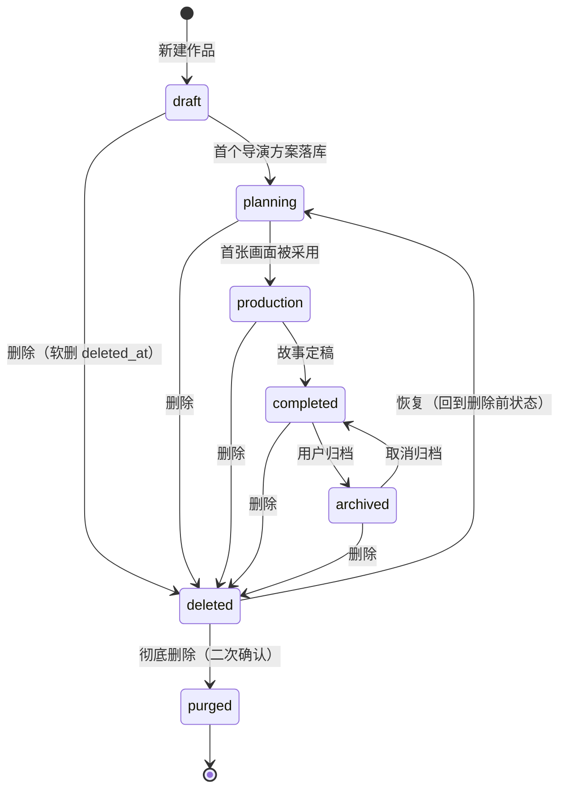
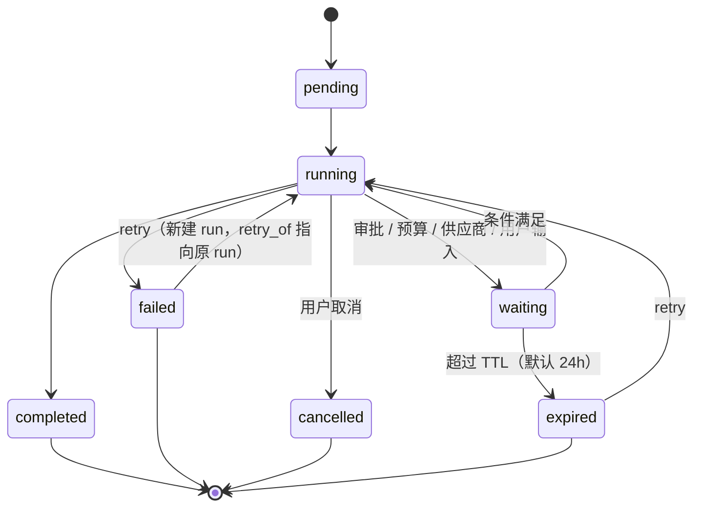
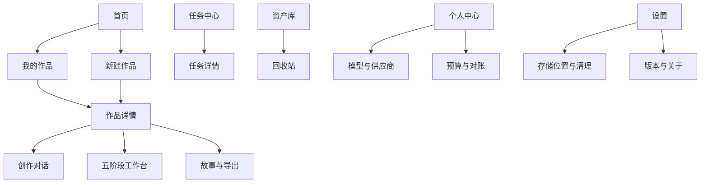

# 下一阶段设计：完整性 / 合理性 / 体验度

- 建立日期：2026-11-22
- 基线：`main = b4cbc20`（与 `origin/main` 一致）
- 范围：产品信息架构、对象生命周期、写协议与接口契约、前端呈现方式
- 不覆盖：多用户/多租户、主题与国际化、模型供应商接入、视频真实 Provider

这是设计决策文档，不是待办清单。每条都给出「为什么这样设计」；实现按 §7 分期落地。
与既有债务冲突处以 [架构例外清单](../architecture/exceptions.md) 的冻结范围为界（见 §8）。

---

## 1. 四条不变量

设计任何新东西前先过这四条，过不了就不做：

| # | 不变量 | 含义 | 反例 |
|---|---|---|---|
| I1 | 不新增第二套状态 | 状态只存在于 `core/runtime` 与领域版本链；前端只派生视图 | 前端用 `phase`/`onBase`/`draft` 组合判断按钮可用性 |
| I2 | 不新增平行入口 | 同一能力复用既有 Store / Service / 协议 | 为"作品归档"另建一套 service |
| I3 | 每个状态都有出口 | 用户停在任何状态都能看到一个可执行动作 | 作品被软删后列表里查不到、也无法恢复 |
| I4 | 用户可见的等待必须可离开 | 超过 2s 的操作不绑定页面存活 | 关掉标签页后不知道任务有没有跑完 |

I1、I2 来自 [AI 代码规则](../engineering/AI_CODE_RULES.md) 与 EX-09 的冻结方向；I3、I4 是本阶段新增的产品约束，写进评审口径。

---

## 2. 事实基线

设计必须落在这些已核实的事实上（不是推测）：

| # | 事实 | 影响 |
|---|---|---|
| F1 | **`works` 层的写协议已经是正确的**：`workspace.py` 每个写方法都是 `BEGIN IMMEDIATE` → `_replay`（`request_id` 指纹回放）→ `_cas`（`expected_version`）→ `_append`（版本追加）→ `_advance_project` → `_finish` | 幂等、并发、软删、重命名**都已具备**，不需要重新发明 |
| F2 | **`comic_projects.status` 是死字段**：建表允许 `draft/planning/production/completed/archived`，但全库只有 `INSERT` 时写一次，之后没有任何 `UPDATE` | 表里有状态却从不推进，于是界面只能读 payload 里的派生值 → 状态无单一来源 |
| F3 | **存在两套删除语义**：`works` 用 payload 里的 `deleted_at`（软删，`list()` 过滤掉，**无恢复接口**）；`artifacts` 用 `lifecycle_state`（active/trashed/purging/purged，**有 restore/purge**） | 用户删作品＝永久消失，删资产＝可恢复；同一产品两种心智 |
| F4 | **run 与 batch 两套终态**：run 六态无 `expired`、无 `waiting_reason`；batch 多一个 `partial_failed` | 界面要写两套判断，且无法表达"部分成功" |
| F5 | **成本不可见**：`ledger` 有预留/实扣/`unknown`，但前端零呈现，只能在 yaml 改预算 | 生成前不知道花多少，`unknown` 只能靠人查库对账 |
| F6 | **作品列表只在工作台内部**：`GET /api/comic/works` 与 `listComicWorks()` 存在，但只被 `DirectorWorkspace.vue` 用于切换作品；首页是对话流，没有"我的作品" | 用户找一部三个月前的作品只能翻会话历史 |

结论：**这个项目不缺"高级机制"，缺的是把已经验证过的那一套变成全局约定**。下面的设计绝大部分是"收敛"，不是"新增"。

---

## 3. 完整性：四个生命周期

### 3.1 对象 × 生命周期总表

| 对象 | 现状（代码事实） | 缺的出口 | 设计动作 |
|---|---|---|---|
| 作品 `works` | create / get / list / rename / delete + CAS + replay + 软删 | **恢复**、**归档**、**回收站**、列表按状态过滤 | 补 3 个接口；用 `comic_projects.status` 承载阶段，`deleted_at` 承载删除 |
| 项目 `comic_projects` | 只有 create 与按 id 读；`status` 从不更新 | 状态推进 | **让 status 由 work 生命周期推进**（同一事务内已有 `_advance_project`） |
| 任务 `runs`/`batches` | 六态；batch 另有 `partial_failed`；cancel 已有 | `expired`、`waiting_reason`、`retry`、run 级 `partial` | 扩词表 + 补 retry |
| 资产 `artifacts` | 四态完整，restore/purge 已有 | 独立回收站视图与保留期告知 | 只补界面，后端不动 |
| 成本 `ledger` | 预留 → 实扣 / `unknown` | 查询、对账动作、用户可见 | 补 2 个接口 |

设计原则：**生命周期是对象的属性，不是页面的属性**。同一作品在首页、工作台、任务中心看到的状态必须一致，
因此状态只从后端出（见 §4.1）。

### 3.2 作品：把死字段变成真状态

关键决策：**不再为作品新增状态列**，而是让 `comic_projects.status` 真正被推进。
理由有三：① 字段已存在，`CHECK` 已允许 `archived`，加写入路径不触发数据迁移；② `works` 与 `projects` 共用同一 id
（`_advance_project(connection, work_id, ...)`），同一事务内即可更新；③ 列表查询可以从
`json_extract(payload_json,'$.deleted_at') IS NULL` 这种全表扫描降级为列过滤（可加索引）。



约束：

- **状态推进由事实驱动，不由按钮驱动**：有方案→`planning`，有采用画面→`production`，故事定稿→`completed`。
  用户唯一能手动设置的是 `archived`（归档/取消归档）。
- 删除保留 `deleted_from_status`；恢复回到该状态，**不是一律回 draft**。
- `deleted` 的作品不出现在默认列表；`?status=deleted` 才返回，供回收站使用。
- `purge` 才真正清理 `comic_entity_versions` 与关联产物，顺序必须是「先清子表、再删主表」，每步单独提交
  （Core 生命周期切换自带 `BEGIN IMMEDIATE`，不能嵌套在作品事务里）。

配套接口（沿用仓库既有 `POST /{id}/{动作}` 风格，与 `works/{id}/delete` 一致）：

```
POST /api/comic/works/{id}/restore     {request_id, expected_version}
POST /api/comic/works/{id}/archive     {request_id, expected_version, archived: true|false}
POST /api/comic/works/{id}/purge       {request_id, expected_version, confirm_title}
GET  /api/comic/works?status=active|archived|deleted&before=&limit=
```

删除已存在（`works/{id}/delete`），恢复与彻底删除是缺口；`purge` 要求 `confirm_title` 与标题逐字一致，
把"不可逆"变成用户必须付出的一次动作。

### 3.3 任务：统一词表，分开粒度

run 与 batch 各写一套判断是界面侧的主要复杂度来源。设计上统一词表：

- run：`pending → running → waiting → (completed | failed | cancelled | expired)`
- batch：在 run 词表上加 `partial`（至少一个子任务成功、至少一个失败），替换现在的 `partial_failed`
- `waiting` 必须带 `waiting_reason`（`approval` / `budget` / `provider` / `user_input`），否则用户不知道在等谁



约束：

- `retry` 不重置原 run，而是新建 run 并记录 `retry_of`。失败证据保留，可回溯性不受影响。
- `expired` 只对 `waiting` 生效，必须落 `run_expired` 事件，供任务中心显示"长时间未处理而结束"。
- 取消只保证本系统不再推进；provider 侧靠 `provider_job_id` 事后收口，界面**不得**承诺"已停止扣费"。

### 3.4 成本：从"有台账"到"可见可对账"

```
GET  /api/budget                 → 本期预算、已用、预留中、未知待对账
POST /api/budget/reconcile       {reservation_id, actual_fen, note}
```

约束：`unknown` 不允许被对账成 0，也不允许自动转 `failed`；对账是人工动作，必须有操作者与时间。

---

## 4. 合理性：三条结构约束

### 4.1 单一状态源：`available_actions` 从导演域推广到全部资源

事实：`coordinator.py` 已输出 `available_actions`，`DirectorWorkspace.vue` 已按它渲染按钮。
这个模式是对的，但只覆盖导演阶段；其余位置仍在前端推导——`ImageOptimizeStage.vue` 用
`phase === 'editing'`、`onBase`、`draft` 组合判断"框选"是否可用，项目记录里出现过按钮误灰、需要点击时自恢复的问题。

设计：**所有资源响应都带 `available_actions`，前端只渲染，不推导。**

统一动词表（前后端各一份，测试比对一致性）：

| 资源 | 动作 |
|---|---|
| 作品 | `view` `rename` `archive` `restore` `delete` `purge` `open` |
| 任务 | `view` `cancel` `retry` `resume` `approve` `reject` |
| 资产 | `view` `restore` `purge` `set_base` `compare` |
| 成本 | `view` `reconcile` |

判定写在领域层：状态 + 引用关系（是否被故事/正作引用）+ 权限三者都满足才返回。
前端拿到空数组就只读展示，**不再出现"按钮在、点了报错"**。

这是"合理性"的核心：把"能不能做"从界面移到领域，界面只负责"怎么做"。

### 4.2 写协议统一：把 `works` 那一套变成全局约定

F1 说明幂等与并发控制已经解决，问题只是**只有 `works` 在用**。设计上把它定为唯一写协议，
其余入口按同一顺序补齐，而不是各写一套：

```
BEGIN IMMEDIATE
  → replay(request_id, fingerprint)   命中则回放，指纹不符则拒绝
  → cas(expected_version)             版本不符则拒绝
  → append(版本追加 + payload)
  → advance(容器 current_version + 1)
  → finish(记录 operation + request + result)
```

适用范围（按价值排序）：作品恢复/归档/彻底删除 → 审批决策 → Prompt 确认 → 故事确认 → 图片删除。
实现上把 `_replay` / `_finish` 收敛为共享能力（EX-09 明确禁止复制事件/恢复实现）；
存储位置复用现有版本链，**不新增业务表**。

### 4.3 契约：错误四元组

统一结构：

```json
{"code": "work_version_conflict", "message": "作品已被修改，请重新读取后再保存",
 "remedy": "reload_and_retry", "error_id": "err-..."}
```

- `code` 稳定机读标识，前端据此决定按钮，不解析文案
- `message` 给用户的一句话，不出现堆栈与内部模块名
- `remedy` 可执行的下一步：`retry` / `reload_and_retry` / `fix_input` / `contact_support` / `none`
- `error_id` 与日志、`trace_id` 关联

现状是只有文案 + `error_id`，前端无法判断"能不能重试"，于是要么全给"重试"要么干脆不给。

---

## 5. 体验度：三条主线 + 一条底线

| 主线 | 判据（可验收） | 落地 |
|---|---|---|
| **可见** | 任何 >2s 的操作，界面能回答"在做什么 / 到哪一步 / 还要多久 / 花多少" | 任务中心常驻进度与 `waiting_reason`；生成前显示预计费用与余额；标题角标显示运行中任务数 |
| **可恢复** | 任何失败都有可点的下一步；任何删除都可撤回 | `remedy` → 按钮；作品与资产统一进回收站；SSE 已有 `Last-Event-ID`，前端补"重连中/已恢复"状态 |
| **可离开** | 关标签页、切页面，回来任务仍在、结果不丢 | 后端已具备（线程池 + checkpoint + SSE 续传），缺前端三个元素：任务中心、标题角标、完成提醒 |
| **术语底线** | 主路径只出现：作品 / 方案 / 画面 / 版本 / 镜头 / 花费 | `DirectorSpec`、`Critic`、门禁、产物只在详情与 tooltip 中出现 |

"可离开"是投入产出最高的一块：不需要改架构，后端已经做完了，只缺把这件事**表达出来**——
现在用户只能盯着同一个页面。

术语底线不是文案工作，它影响合理性：创作者看到"Critic 未通过，门禁阻断"不知道改什么；
看到"画面评审未通过：镜头 3 人物朝向与设定不一致"就知道改哪。

---

## 6. 信息架构：作品升为一级对象

现状是**会话驱动**：首页是对话流，作品列表只藏在工作台内部（F6）。用户心智是**作品驱动**：
"我那个雨夜天桥的片子做到哪了"。



关键决策：

- **作品是容器，会话是入口。** 一个作品可有多条会话；会话列表降级为作品内的时间线，不再是全局导航。
- **任务中心是全局的**，不挂在作品下。用户关心"机器在忙什么"，不是"这个作品在忙什么"。
- **回收站是资产库的 tab**，同时收纳被删作品。现在两种删除语义（F3）必须在这里统一。
- **设置页保持"只做入口"** 是正确设计——不放没有接口的开关。等 §3.4 与存储清理接口补齐后再往里加。

---

## 7. 分期与验收

每期以"用户能完成一件以前做不到的事"验收，不以"代码写完"验收。

### 第 1 期 · 补出口（8~10 天）

- 作品恢复/归档/彻底删除 + `status` 由生命周期推进（§3.2）
- 任务 `retry` / `expired` / `waiting_reason`（§3.3）
- 回收站 tab 统一收纳作品与资产（§6）
- `available_actions` 推广到作品、资产、任务（§4.1）

验收：① 删错的作品能恢复且回到原状态；② 失败任务一键重跑、原 run 仍在；③ 归档作品不再出现在默认列表但可检索；
④ 前端抽查 5 个页面，不存在"按钮可点但报错"的路径。

### 第 2 期 · 补信任（10 天）

- 生成前费用预估与预算余额；`/api/budget` 与对账（§3.4）
- 错误四元组 + `remedy` → 按钮（§4.3）
- 完成提醒：标题角标 + 任务中心红点（不做桌面推送，避免新依赖）
- 写协议推广到审批决策、Prompt 确认、故事确认（§4.2）

验收：① 生图前看到预计花费；② 任一失败能指出下一步；③ 切页面回来进度不丢；④ 双击"确认"只产生一次版本推进。

### 第 3 期 · 补体质（10 天）

- `/health` `/ready` + 6 个指标（任务时长、失败率、恢复次数、模型延迟、费用、SSE 连接）
- 缩略图与强缓存（`/api/artifacts/{id}/content` 当前默认 `no-store`，内容按 sha 命名本可 `immutable`）
- 消息与版本列表虚拟滚动
- OpenAPI 快照测试；CI 从 5 个测试文件扩到全量

验收：① 30 张图的版本列表首屏 < 2s；② 连续滚动 200 条消息不掉帧；③ CI 全绿且覆盖率可读。

---

## 8. 与既有例外清单的关系

本设计刻意避开三条已登记债务的冻结范围：

- **EX-09**（Coordinator / GraphRuntime / Shell 各自维护 Run 生命周期）：本文只做**词表与视图派生**，
  不新建 Orchestrator、不复制取消/事件/恢复实现。`expired`、`waiting_reason` 走既有 Runtime 钩子；
  `_replay`/`_finish` 的收敛属于"在既有 Runtime 钩子上收敛"，不是新框架。
- **EX-14**（自由字符串 status、前端重复状态）：本文正是它的退出条件——先定转换表与终态语义，
  再收前端推导。落地顺序必须是「先补 `waiting_reason`/`expired`/`status` 写入，再删前端推导」，不能反。
- **EX-10**（`trace` 表缺 run/artifact/request 关联）：第 3 期指标不新建 Trace 系统，在既有表上增量补关联。

---

## 9. 明确不做

- 不做多主题、多语言
- 不引入新的状态机/工作流框架（含 LangGraph），继续用 `core/runtime/graph.py`
- 不重写 `web_studio.py`、`projects.py`、`workspace.py` 等巨文件；巨文件拆分另立治理项
- 不为"设置页看起来完整"加没有后端支撑的开关
- 不把 `unknown` 账单当 0，不为通过验收放宽任何门禁
